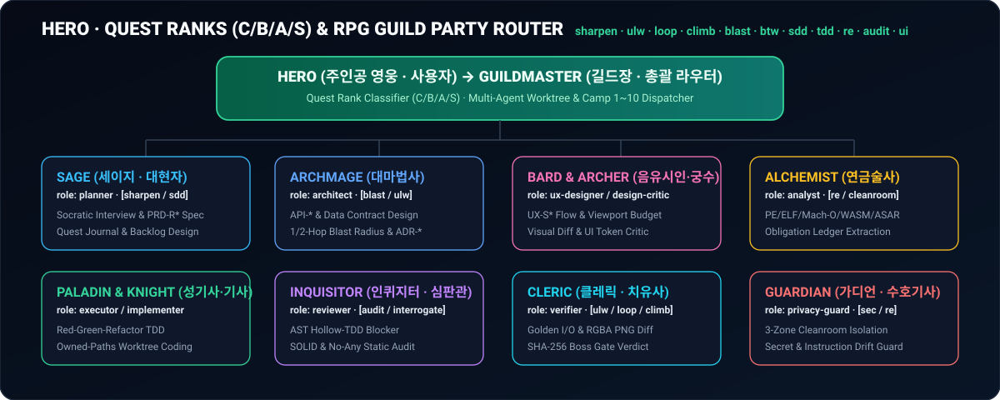

<div align="center">


<br/>

**[🇺🇸 English](README.md)** | **[🇰🇷 한국어](README.ko.md)** | **[🇯🇵 日本語](README.ja.md)** | **[🇨🇳 简体中文](README.zh-CN.md)**

<br/>

[](package.json)
[](LICENSE)
[](pyproject.toml)
[](harness/mcp_server.py)
[](harness/autopilot_engine.py)
[-ec4899?style=for-the-badge)](pyproject.toml)

**An All-in-One 6-Host Agentic Harness for Visible Korean Prompt Expansion (`sharpen` + Socratic Interview + Next Actions), SDD + TDD Execution, 2-Tier Cleanroom Reverse Engineering (Built-in + Optional Boosters), Autonomous Metric Climbing, Blast-Radius Verification, and Self-Healing Autopilot.**

</div>

---

## ✨ Why Dreampia-Skill?

Modern AI coding assistants often interpret short prompts shallowly, skip edge cases, hallucinate completion without runtime evidence, or break when heavy external reverse-engineering tools fail to install. **Dreampia-Skill** solves this with a 100% original cleanroom Python 3.9+ harness (owned by Dreampia under **Apache-2.0**, zero third-party pip dependencies) that installs across **Antigravity, Claude Code, Cursor, Codex, OpenCode, and Gemini CLI** in one command:

1. **🧠 Visible Korean Prompt Expansion & Socratic Requirement Interview (`expand-prompt` / `sharpen` / `next-actions`)**: Transforms terse user (**Hero**) quest requests into a structured Korean engineering prompt (automatically injecting SOLID 5 principles, zero-`any` type safety, optional UI rules, and defensive edge cases) plus **3 domain-tailored Sage Socratic clarifying questions** and **Next Actions** echoed visibly at the top of the chat.
2. **🔬 2-Tier Cleanroom Reverse Engineering & Booster Planner (`reconstruct-doctor`)**:
   - **Tier 1 (Zero-Dependency Built-in Engine)**: Instantly parses `PE/ELF/Mach-O/WASM/ASAR/APK/ZIP/Source` headers and public surfaces without any external binaries, enforcing 3-zone cleanroom isolation (`contaminated-zone` / `approved-spec` / `implementation`) and 100% `Obligation Ledger` closure.
   - **Tier 2 (Optional External Boosters)**: Automatically detects host package managers (`winget`, `scoop`, `choco`, `brew`, `apt-get`), plans opt-in CLI installations (`--install-tool <id|all> [--apply]`, blocking unapproved `sudo` or MCP remote installs) for `rizin`, `jadx`, `ghidra`, `wasm2wat`, `objdump`, `nm`, and `adb`, and merges deep symbols with a 5-second non-destructive timeout.
3. **⚔️ Fantasy RPG Hero & Guild Party Squad + 13 Magic Prompt Shorthands**: Treats the user as the protagonist **`Hero`** issuing quests (`C/B/A/S` ranks) commanded by `GuildMaster` with specialized party classes (`Sage`, `Archmage`, `Bard`, `Paladin`, `Inquisitor`, `Cleric`, `Guardian`, `Alchemist`, `Archer`) and triggered via 13 short keywords (`sharpen`/`구체화`, `ulw`, `loop`, `climb`, `blast`, `interrogate`, `unslop`, `btw`, `sdd`, `tdd`, `re`, `audit`, `ui`).
4. **🛡️ Zero-Collision State Isolation & Reversible Global Setup**: Automatically detects existing unmanaged `.dreampia/` application data folders and isolates skill state into `.dreampia-skill/`. Global setup (`setup --apply`) backs up preexisting non-Dreampia skills (`.pre-dreampia.bak`) and restores/removes cleanly via `uninstall-global --apply`.

---

## ⚡ 10-Second One-Click Installation

Choose any installation method below. **No `pip install` or virtual environment setup is required**—Dreampia-Skill runs purely on the Python 3.9+ standard library (`bin/dreampia.cjs` automatically probes `python3`, `python`, and `py -3` on Windows/macOS/Linux).

### Method 1. `npx` Zero-Clone Global Setup & Uninstall (Recommended)
Run a single command in your terminal (Windows PowerShell or macOS/Linux) to configure global skill directories (Antigravity, Claude Code, Cursor, Gemini CLI, Agents) and register the Antigravity global `dreampia-skill` MCP server:

```bash
# Global install (backs up any non-Dreampia skill of the same name)
npx github:eonofpixel/Dreampia-Skill setup --apply

# Global uninstall & backup restore (preview without --apply, execute with --apply)
python -m harness.team_cli uninstall-global --apply
```

### Method 2. Ask Your AI Assistant (Copy & Paste)
Paste this single sentence into Antigravity, Claude Code, Cursor, Codex, OpenCode, or Gemini CLI:

> ```text
> Clone https://github.com/eonofpixel/Dreampia-Skill and run python -m harness.team_cli setup --apply to install Dreampia-Skill globally.
> ```

### Method 3. Native Host Plugin Marketplaces & Manual Clone

| AI Host | Native One-Liner Command |
| :--- | :--- |
| **Claude Code** | `/plugin marketplace add eonofpixel/Dreampia-Skill` &#8594; `/plugin install dreampia-skill` |
| **Cursor** | `/add-plugin https://github.com/eonofpixel/Dreampia-Skill` (via `.cursor-plugin/plugin.json`) |
| **Gemini CLI** | `gemini extensions install https://github.com/eonofpixel/Dreampia-Skill` |
| **Git Clone (Windows / macOS)** | `git clone https://github.com/eonofpixel/Dreampia-Skill.git && cd Dreampia-Skill && python -m harness.team_cli setup --apply` |

---

## 🧠 Visible Korean Prompt Expansion & Socratic Interview (`expand-prompt`)

When you type a short prompt like `"구체화 결제 버튼 만들어줘"`, Dreampia-Skill expands your intent into a concise Korean quest operational briefing and Socratic interview block before writing code:

```bash
python -m harness.team_cli expand-prompt --project . --goal "구체화 결제 버튼 만들어줘"
```

- **Auto-Injected Engineering Constraints**: SOLID 5 principles, zero `any`, explicit return types & Props interfaces, optional `bg-transparent` + hover/focus buttons & `lucide-react` icons (can be disabled per project via `"enforce_ui_rules": false`), and Korean user-facing error messages.
- **Sage Socratic Clarifying Questions (`clarifying_questions_ko`)**: Generates 3 domain-specific Korean interview questions tailored to UI, Security/Auth, Cleanroom RE (`re`), Metric Climb (`climb`), or General API/Module work whenever `prompt-sharpen` (`sharpen` / `구체화`) is active or ambiguity is high.

---

## ⚔️ Fantasy RPG Hero, Quest Ranks (`C/B/A/S`) & Guild Party Architecture

<div align="center">
  
</div>

| Class Callsign | Korean Title | Role Key | Core Responsibility & Write Boundary |
| :--- | :--- | :--- | :--- |
| **`Hero` (User)** | 주인공 영웅 | `protagonist` | Quest Issuer & Supreme Expedition Commander (Final direction & Merge approval) |
| **`GuildMaster`** | 길드마스터 (길드장) | `commander` | Chief Quest Router — Classifies Quest Rank (`C/B/A/S`), forms Guild Party, and dispatches worktrees |
| **`Sage`** | 세이지 (대현자) | `planner` | Socratic Interviewer & Quest Journal (`PRD-R*` / `REQ-*` / Backlog) Designer |
| **`Archmage`** | 아크메이지 (대마법사) | `architect` | System, API Contract, Trust Boundary & 1/2-Hop Blast-Radius (`blast`) Architect |
| **`Paladin` / `Knight`** | 팔라딘 (성기사) / 나이트 (기사) | `executor` / `implementer` | TDD Core Executor & Cleanroom Reconstructor (`src/`, `harness/`, `implementation/`) |
| **`Archer` / `Bard`** | 아처 (궁수) / 바드 (음유시인) | `design-critic` / `ux-designer` | UI/UX Journey Designer, Responsive Viewport & Visual/Token Critic (`app/`, `components/`) |
| **`Alchemist`** | 알케미스트 (연금술사) | `analyst` | 2-Tier Cleanroom Reverse Engineer & Obligation Ledger Synthesizer (`contaminated-zone/` &#8594; `approved-spec/`) |
| **`Inquisitor`** | 인퀴지터 (심판관) | `reviewer` | Static AST Code Auditor (`audit-code`) & Adversarial Reviewer (`tests/`) |
| **`Cleric`** | 클레릭 (치유사) | `verifier` | Runtime Evidence, Self-Healing Loop (`loop`), Metric-Climb & Boss Gate (`autopilot-gate`) Verifier |
| **`Guardian`** | 가디언 (수호기사) | `privacy-guard` | PII, Secret Sanitization, Instruction Drift & 3-Zone Cleanroom Boundary Guardian |

- **Quest Ranks (`C / B / A / S`)**: `C` (`quick` — 2-agent fast strike), `B` (`team` — 4-agent standard party), `A` (`controlled` — full siege party with security/architecture gates), `S` (`cleanroom` — 3-zone zero-contamination reverse-engineering & reconstruction).
- **Multi-Agent Single-PC & Multi-Camp (`camp-01` ~ `camp-10` / `bot-01` ~ `bot-10`) Deployment**: A single Windows PC or Mac Mini can host a full 4–6 agent Guild Party concurrently via isolated Git Worktrees (`.dreampia/worktrees/paladin-executor`, `archer-ui`, `inquisitor-test`), while 1–10 physical machines (`camp-01` ~ `camp-10`) act as multi-party expedition camps controlled from the Dreampia AI Browser or Mobile Remote App.

---

## 🚀 13 Magic Prompt Shorthands

Trigger specialized workflows immediately by prefixing or including these shorthand tokens in your prompt:

| Shorthand | Korean Alias | Activated Mode & Pipeline | Example Prompt |
| :---: | :---: | :--- | :--- |
| **`sharpen`** / `boost` | `고도화`, `구체화`, `생각` | **Visible Korean Prompt Expansion + Socratic Interview**<br/>Expands terse prompts with constraints, edge cases, and 3 clarifying questions | `"구체화 결제 버튼 만들어줘"` |
| **`ulw`** / `ultrawork` | `풀가동`, `오토파일럿` | **Full Guild Party + Autopilot Gate**<br/>Forces A-rank `controlled` party mode and 5-stage verification | `"ulw refactor auth module and add JWT rotation"` |
| **`loop`** / `until-pass` | `루프`, `완주`, `끝까지` | **Self-Healing Pass/Fail Loop**<br/>Retries test/audit commands until all blockers reach `0` | `"loop fix all failing payment webhook tests"` |
| **`climb`** / `hillclimb` | `성능등반`, `자율실험` | **Autonomous Metric-Climb Engine**<br/>Immutable eval guard + SHA-256 dedup + Monte Carlo significance + TSV ledger | `"climb minimize parser latency below 5ms"` |
| **`re`** / `cleanroom` | `역설계`, `클린룸` | **2-Tier Cleanroom Reverse Engineering**<br/>Tier 1/2 static inspection &#8594; 3-zone isolation &#8594; Obligation Ledger & Golden I/O parity | `"re analyze legacy binary and rebuild in Python"` |
| **`blast`** | `폭발반경`, `영향도` | **Cross-Module Blast-Radius & 5-Level Safety Proof**<br/>Traces 1-hop/2-hop callers, boundary crossings, and runtime proof level | `"blast check impact of changing route_planner.py"` |
| **`interrogate`** | `심문`, `적대적리뷰` | **Multi-Perspective Adversarial Diff Review**<br/>Simultaneously attacks changes from Archmage, Inquisitor, and Guardian lenses | `"interrogate review this PR diff for edge-case bugs"` |
| **`unslop`** / `deslop` | `군더더기제거`, `슬롭제거` | **Anti-Slop AST Code & Comment Sanitizer**<br/>Eliminates bare `except: pass`, tautological tests, and dead wrappers | `"unslop clean up the new service layer"` |
| **`btw`** | `잠깐`, `빠르게` | **Zero-Pollution Side Research**<br/>Routes to `Sage` (`side-query` mode) without mutating project files | `"btw check where router discovery is configured"` |
| **`sdd`** | `명세`, `설계` | **Spec-Driven Development (`sdd-ledger` / `sdd-check`)**<br/>Enforces `PRD-R*` / `SPEC-*` &#8594; `TASK-*` / `T*` &#8594; `TEST-*` traceability ledger | `"sdd design multi-tenant billing subscription API"` |
| **`tdd`** | `티디디` | **Test-Driven Development**<br/>Enforces failing assertion test first &#8594; minimal implementation &#8594; refactor | `"tdd implement rate-limiter middleware"` |
| **`audit`** | `감사`, `보안점검` | **Inquisitor Static AST Code Audit (`audit-code`)**<br/>Scans SOLID, zero-`any`, return types, anti-slop, and optional UI button/icon rules | `"audit check repository for SOLID and UI violations"` |
| **`ui`** | `화면`, `디자인` | **UI/UX Delivery & Visual Check (`visual-check`)**<br/>Enforces `bg-transparent` buttons, `lucide-react` icons, and PNG pixel diff budgets | `"ui build dark-mode analytics dashboard"` |

---

## 🔬 2-Tier Cleanroom Reverse Engineering (`reconstruct-doctor`)

```bash
# 1. Diagnose Tier 1 built-in engine, host package managers (winget/scoop/brew/apt), and Tier 2 tools
python -m harness.team_cli reconstruct-doctor

# 2. Preview installation plan for optional Tier 2 boosters (rizin, jadx, ghidra, wasm2wat, objdump, nm, adb, or all)
python -m harness.team_cli reconstruct-doctor --install-tool rizin,jadx

# 3. Execute opt-in CLI installation (--apply required; sudo and MCP remote installs are blocked)
python -m harness.team_cli reconstruct-doctor --install-tool rizin,jadx --apply
```

---

## 🛡️ Verification Pipeline CLI Commands (Self-Dogfooding Ready)

```bash
# 1. Static AST Code Audit (--apply writes evidence/code-audit.json; --no-ui-rules skips UI token checks)
python -m harness.team_cli audit-code --project . --apply

# 2. 1-Hop/2-Hop Blast-Radius & 5-Level Safety Proof Analysis
python -m harness.team_cli blast-radius --project . --target harness/route_planner.py

# 3. Token-Saving Context Pack Compilation
python -m harness.team_cli context-pack --project . --goal "Upgrade cleanroom engine"

# 4. Unified Autopilot Gate
python -m harness.team_cli autopilot-gate --project . --allow-doc-only

# 5. Project Self-Learning Rule Memory (auto-enforced by audit-code & expand-prompt)
python -m harness.team_cli learn-rule --project . --rule "Never use float for currency" --forbidden-regex "\bfloat\s*\(" --apply

# 6. Sage Interview Answers -> SDD Spec Compiler (PRD-R* / TASK-* / TEST-*)
python -m harness.team_cli interview-compile --project . --goal "Build checkout button" --answers "1440px,Toast feedback,0.01" --apply

# 7. Cleanroom Korean Spec & Golden I/O Synthesizer
python -m harness.team_cli reconstruct-spec --project . --source contaminated-zone --apply

# 8. Git Worktree Parallel Guild Party Orchestrator (Paladin / Archer / Inquisitor; supports --mode or --action)
python -m harness.team_cli squad-worktree --project . --mode plan --goal "Parallel payment refactor"

# 9. State-Aware Next Action Navigator (1st~3rd priority recommendations)
python -m harness.team_cli next-actions --project . --goal "Build checkout button"

# 10. Zero-Trust Guild Camp (bot-01~bot-10) Multi-Party Assignment, 6-Digit Pairing, HMAC-SHA256 Signed Quests & Boss Merge Guard
python -m harness.team_cli guild-camp --project . --mode status
python -m harness.team_cli guild-camp --project . --mode pair --slot bot-01 --party "Paladin,Archer,Inquisitor,Cleric" --apply
python -m harness.team_cli guild-camp --project . --mode dispatch --slot bot-01 --goal "Refactor payment module with TDD" --apply
python -m harness.team_cli guild-camp --project . --mode merge-guard --slot bot-01 --hero-approve
```

---

## ⚡ Standard Slash & CLI Operational Commands (Prefix-Free 1:1 Mapping)

All operational lifecycle commands use clean, prefix-free names in both IDE slash commands (`/command` via `commands/*.md`) and terminal CLI (`npx dreampia <command>` or `python -m harness.team_cli <command>`):

| Slash Command (`commands/*.md`) | CLI Command (`npx dreampia ...`) | MCP Tool | Description |
| :--- | :--- | :--- | :--- |
| `/version` | `version --check-remote` | - | Show local version, Git commit/branch, and remote `origin/main` status |
| `/status` | `status --project .` | `dreampia_status` | Unified status dashboard: skill state dir (`.dreampia` or `.dreampia-skill`), UI rule enforcement, SDD regexes, learned rules, and 5-host global sync |
| `/doctor` | `doctor --project . --global --check-remote` | `dreampia_doctor` | Diagnose Python runtime, SHA-256 bundle manifest, unmanaged `.dreampia/` data collision, and 5-host global sync |
| `/config` | `config --project . --ui-rules off --apply` | `dreampia_config` | Inspect or update per-project settings (`--ui-rules on\|off`, `--state-dir`, `--task-pattern`) |
| `/update` | `update --global --apply` (`self-update --apply`) | `dreampia_self_update` | Pull latest `origin/main`, refresh bundle manifest, and re-sync all 5 global host skill directories |
| `/uninstall` | `uninstall --global --apply` (`uninstall-global --apply`) | - | Safely remove global 5-host skills (restoring `.pre-dreampia.bak` backups) or project-scoped managed files |
| `/release` | `release --to <X.Y.Z> --apply` (`bump-version`) | `dreampia_release` | Atomically bump version constants, docs, `bundle-manifest.json`, and `CHANGELOG.md` across the repository |
| `/clean` | `clean --project . --apply` | `dreampia_clean` | Safely clean up temporary parallel guild party worktrees, interrupted transaction journals, and optional evidence caches |

---

## 🔌 30 Native MCP Server Tools (`harness/mcp_server.py`)

When installed via `setup --apply`, `harness/mcp_server.py` exposes **30 tools** directly to your MCP-compatible IDE or agent:

| Category | MCP Tool Name | Description |
| :--- | :--- | :--- |
| **Operations & Lifecycle** | `dreampia_status` | Unified project & 5-host global status dashboard (`.dreampia-skill` isolation, UI rules, SDD patterns, learned rules) |
| | `dreampia_doctor` | End-to-end health, SHA-256 manifest, data-dir collision, and 5-host global synchronization diagnostics |
| | `dreampia_config` | Inspect or update per-project UI rule enforcement (`on`/`off`), state dir, and custom SDD ID regexes |
| | `dreampia_self_update` | Pull latest git changes, rebuild bundle manifest, and re-synchronize all 5 global host skill directories |
| | `dreampia_clean` | Safely clean up parallel guild party worktrees, interrupted transaction journals, and optional evidence caches |
| | `dreampia_release` | Atomically bump version constants, docs, `bundle-manifest.json`, and `CHANGELOG.md` to a target semver |
| | `dreampia_discover` | Brownfield/polyglot/monorepo stack profile discovery (`project-profile.json`) and automatic SDD baseline bootstrapping |
| **Prompt Expansion & Routing** | `dreampia_expand_prompt` | Expand short goals into Korean engineering prompts, constraints (including learned rules), edge cases, 3 Socratic interview questions, and recommended next actions (`echo_markdown_ko`) |
| | `dreampia_next_actions` | Inspect project state (Git, SDD specs/ledger, cleanroom, audit verdict, learned rules) and return 1st–3rd priority next actions with ready-to-copy prompts and CLI commands |
| | `dreampia_interview_compile` | Compile a goal + interview answers directly into `PRD-R*`, `TASK-*`, `TEST-*` specs and refresh `evidence/sdd-ledger.json` |
| | `dreampia_route_plan` | Parse 13 Magic Shorthands and compute deterministic quest rank, guild party roles, and required gates |
| | `dreampia_router_discover` | Discover installed multi-agent harness CLIs and skill synchronization status |
| | `dreampia_squad_worktree` | Plan, create, or clean up isolated Git Worktrees for parallel `Paladin`, `Archer`, and `Inquisitor` party tracks |
| | `dreampia_guild_camp` | Zero-Trust Guild Camp (`bot-01`~`bot-10`) multi-party assignment (`configure`), 0-inbound-port 6-digit pairing (`pair`), HMAC-SHA256 signed quest dispatch/verify, secret/command guard, and boss merge guard (`merge-guard`) |
| **2-Tier Cleanroom RE** | `dreampia_reconstruct_doctor` | Diagnose Tier 1 & Tier 2 RE tools, detect package managers, and preview tool installation plans |
| | `dreampia_reconstruct_inspect` | Static binary/archive/source surface inspection (`PE/ELF/Mach-O/WASM/ASAR/APK/ZIP`) with Tier 2 symbol enrichment |
| | `dreampia_reconstruct_spec` | Synthesize Korean cleanroom specification (`approved-spec/00_CLEANROOM_SPEC.md`) and `golden-io.json` vectors from artifact inspection |
| | `dreampia_reconstruct_ledger` | Build Cleanroom Reconstruction Obligation Ledger from `contaminated-zone` |
| | `dreampia_reconstruct_verify` | Verify 100% Obligation Ledger coverage and 3-zone zero-contamination boundaries |
| | `dreampia_reconstruct_compare` | Compute surface parity ratio (`exports`, `routes`, `ipc_channels`) between source and candidate |
| | `dreampia_golden_io` | Verify black-box behavioral parity against `approved-spec/golden-io.json` vectors |
| **Autopilot & Static Audit** | `dreampia_autopilot_gate` | Run full 5-stage Unified Autopilot Verification Pipeline and emit tamper-evident verdict |
| | `dreampia_audit_code` | Run Inquisitor static AST audit (fake tests, `any` ban, return types, anti-slop, button `bg-transparent`, `lucide-react`, and learned regex rules) |
| | `dreampia_learn_rule` | Persist project-specific engineering rules and `forbidden_regex` patterns into `.dreampia/memory/project-rules.json` |
| | `dreampia_blast_radius` | Compute 1-Hop/2-Hop symbol dependents, boundary crossings, and 5-level safety proof |
| | `dreampia_metric_climb` | Run autonomous metric climbing with immutable file guard, SHA-256 dedup, and Monte Carlo significance |
| | `dreampia_context_pack` | Compile ultra-compact SDD/task/invariant context packet (`evidence/context-pack.json`) |
| **SDD & Visual Gates** | `dreampia_sdd_ledger` | Build bidirectional traceability ledger (`PRD-R*` &#8594; `TASK-*` &#8594; `TEST-*`) |
| | `dreampia_sdd_check` | Fail-closed check for orphan specs, spec drift (`STALE`), and real TDD test files |
| | `dreampia_visual_check` | Verify UI visual acceptance manifest, PNG dimensions, viewport budgets, and pixel diff ratios |
| | `dreampia_verify_gate` | Run stage-specific quality gates (`before-dev-start`, `before-claim-complete`, `before-client-send`, `app-static`, `ui-evidence`) |

---

## 📜 License & Cleanroom Notice

Distributed under the **[Apache License 2.0](LICENSE)**.
- Includes an explicit patent license grant (Section 3) and redistribution attribution protections (Section 4).
- Cleanroom Reverse Engineering workflows (`re` / `reconstruct-*` / `golden-io`) enforce strict 3-zone contamination isolation and operate on observable black-box specifications. See [NOTICE](NOTICE) for details.
