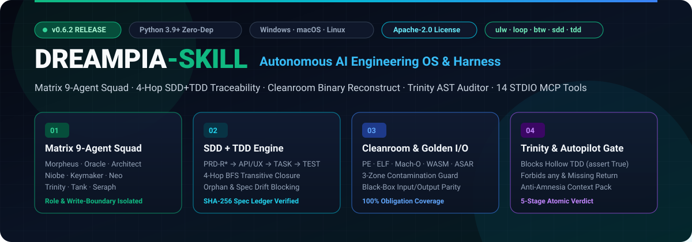

<div align="center">



<br/>

**[🇺🇸 English](README.md)** | **[🇰🇷 한국어](README.ko.md)** | **[🇯🇵 日本語](README.ja.md)** | **[🇨🇳 简体中文](README.zh-CN.md)**

<br/>

[](package.json)
[](LICENSE)
[](pyproject.toml)
[](harness/mcp_server.py)
[](harness/autopilot_engine.py)
[-ec4899?style=for-the-badge)](pyproject.toml)

**集提示词深度扩展简报（`sharpen` + 苏格拉底式追问 + 下一步推荐行动）、SDD + TDD 研发执行、双层净室逆向工程（内置解析器 + 外部逆向工具）、自主指标攀登（Metric-Climb）、爆炸半径（Blast-Radius）分析与统一自动驾驶门禁于一体的 6 大宿主 AI 智能体套件**

</div>

---

## ✨ 为什么选择 Dreampia-Skill？

传统的 AI 编程助手往往对简短提示词理解浅显、遗漏边界条件、在缺乏运行证据的情况下谎称完成，或者因外部逆向工具安装失败而中断。**Dreampia-Skill** 由 Dreampia 采用 100% 原创净室架构（**Apache-2.0**）基于零第三方依赖的 Python 3.9+ 标准库构建，支持一键部署到 **Antigravity、Claude Code、Cursor、Codex、OpenCode 与 Gemini CLI** 六大主流宿主环境：

1. **🧠 可视化提示词深度扩展与苏格拉底式需求访谈 (`expand-prompt` / `sharpen` / `next-actions`)**：将简短指令自动扩展为完整工程规范（自动注入 SOLID 五大原则、严禁 `any`、显式函数返回类型、`bg-transparent` 按钮与 `lucide-react` 图标规范、防御性边界用例），并生成 **3 个领域定制的 Oracle 苏格拉底式澄清问题**与 **下一步推荐行动（Next Actions）**。
2. **🔬 双层（2-Tier）净室逆向工程与安装规划器 (`reconstruct-doctor` / `reconstruct-spec`)**：
   - **Tier 1（零依赖内置引擎）**：无需任何外部二进制工具即可瞬间解析 `PE/ELF/Mach-O/WASM/ASAR/APK/ZIP/Source` 文件头与公开符号表面，严格执行三区净室隔离（`contaminated-zone` / `approved-spec` / `implementation`）与重建义务台账（`Obligation Ledger`）100% 覆盖验证。
   - **Tier 2（可选外部增强器与安装规划）**：自动检测宿主包管理器（`winget`, `scoop`, `choco`, `brew`, `apt-get`），支持按需安装 `rizin`, `jadx`, `ghidra`, `wasm2wat`, `objdump`, `nm`, `adb`（`--install-tool <id|all> [--apply]`），并在 5 秒超时保护下合并深层符号。
3. **🕶️ 黑客帝国智能体战队 & 13 项魔法提示词简写指令**：由 `Morpheus` 统帅 `Oracle`, `Architect`, `Niobe`, `Neo`, `Trinity`, `Tank`, `Seraph`, `Keymaker`, `Mouse`，通过 13 个简写词（`sharpen`, `ulw`, `loop`, `climb`, `blast`, `interrogate`, `unslop`, `btw`, `sdd`, `tdd`, `re`, `audit`, `ui`）即刻激活对应工程流水线。
4. **🛡️ 100% 自举狗粮验证（全仓 70 个文件 0 警告）**：通过自身的 `audit-code --project .` 静态 AST 审计，全仓 **70 个文件实现 0 阻断缺陷、0 警告（`findings: []`）**。

---

## ⚡ 10 秒一键安装指南（全面支持 Windows / macOS / Linux）

无需配置 `venv` 虚拟环境或执行 `pip install`，任选以下一种方式即可在 10 秒内完成全局部署：

### 方式 1. `npx` 零克隆全局安装（强烈推荐 ⭐）
在终端（Windows PowerShell 或 macOS/Linux）中运行以下单行命令，自动配置本机全部 AI 宿主技能目录并注册全局 `dreampia-skill` MCP 服务器：

```bash
npx github:eonofpixel/Dreampia-Skill setup --apply
```

### 方式 2. 复制一句话让 AI 助手自动安装
将下面这句话直接粘贴到 Antigravity、Claude Code、Cursor、Codex、OpenCode 或 Gemini CLI 对话框中：

> ```text
> 请克隆 https://github.com/eonofpixel/Dreampia-Skill 并运行 python -m harness.team_cli setup --apply 完成 Dreampia-Skill 全局技能与 MCP 服务器的安装。
> ```

### 方式 3. 各宿主原生插件市场命令与手动克隆

| AI 宿主环境 | 原生一键安装命令 |
| :--- | :--- |
| **Claude Code** | `/plugin marketplace add eonofpixel/Dreampia-Skill` &#8594; `/plugin install dreampia-skill` |
| **Cursor** | `/add-plugin https://github.com/eonofpixel/Dreampia-Skill`（原生支持 `.cursor-plugin/plugin.json`） |
| **Gemini CLI** | `gemini extensions install https://github.com/eonofpixel/Dreampia-Skill` |
| **Git Clone (Windows / macOS)** | `git clone https://github.com/eonofpixel/Dreampia-Skill.git && cd Dreampia-Skill && python -m harness.team_cli setup --apply` |

---

## 🚀 13 项魔法提示词简写指令

在提示词开头或句中加入以下简写标记，即可立即激活对应的工程流水线：

| 简写指令 | 韩文别名 | 激活的流水线与行为 | 提示词示例 |
| :---: | :---: | :--- | :--- |
| **`sharpen`** / `boost` | `고도화`, `구체화`, `생각` | **提示词深度扩展 + 苏格拉底式访谈追问 3 选**<br/>将模糊需求扩展为工程约束、边界条件、3 个澄清问题与下一步推荐行动 | `"sharpen 做一个支付按钮"` |
| **`ulw`** / `ultrawork` | `풀가동`, `오토파일럿` | **全战队满血并行 + 统一 Autopilot Gate**<br/>强制开启受控战队模式与全阶段门禁验证 | `"ulw 重构鉴权模块并增加 JWT 自动轮换"` |
| **`loop`** / `until-pass` | `루프`, `완주`, `끝까지` | **自愈式 Pass/Fail 循环**<br/>自动重试测试与静态审计，直到所有阻断项归零 | `"loop 修复所有失败的支付回调单元测试"` |
| **`climb`** / `hillclimb` | `성능등반`, `자율실험` | **自主指标攀登引擎 (`metric-climb`)**<br/>防作弊只读评测守卫 + SHA-256 去重 + 蒙特卡洛显著性 + TSV 台账 | `"climb 将解析器延迟优化到 5ms 以下"` |
| **`re`** / `cleanroom` | `역설계`, `클린룸` | **双层净室逆向工程重建**<br/>Tier 1/2 静态表面分析 &#8594; 三区隔离 &#8594; 义务台账与 Golden I/O 100% 验证 | `"re 分析旧版二进制并用 Python 净室重写"` |
| **`blast`** | `폭발반경`, `영향도` | **跨模块爆炸半径 (`blast-radius`) & 5 级安全证明**<br/>追踪 1-Hop/2-Hop 调用链、系统边界交叉与安全证明等级 | `"blast 检查修改 route_planner.py 的影响范围"` |
| **`interrogate`** | `심문`, `적대적리뷰` | **多视角对抗式代码审讯**<br/>从 Architect、Trinity、Seraph 多视角同时审视变更漏洞 | `"interrogate 严厉审查这个 PR 的边界漏洞"` |
| **`unslop`** / `deslop` | `군더더기제거`, `슬롭제거` | **AI 冗余代码与注释净化器**<br/>拦截静默吞异常 `bare except: pass`、假断言与废话注释 | `"unslop 清理新服务层里的 AI 冗余代码"` |
| **`btw`** | `잠깐`, `빠르게` | **零上下文污染旁路查询**<br/>不修改任何项目文件，由 `Oracle` 即刻回答支线问题 | `"btw 查一下项目里路由器配置在哪里"` |
| **`sdd`** | `명세`, `설계` | **规范驱动开发 (`sdd-ledger` / `sdd-check`)**<br/>强制验证 `PRD-R*` &#8594; `TASK-*` &#8594; `TEST-*` 双向追踪台账 | `"sdd 设计多租户订阅计费 API"` |
| **`tdd`** | `티디디` | **测试驱动开发**<br/>强制遵循“先写失败真实断言测试 &#8594; 最小实现 &#8594; 重构” | `"tdd 实现接口限流中间件"` |
| **`audit`** | `감사`, `보안점검` | **Trinity 静态 AST 代码审计 (`audit-code`)**<br/>一键检查 SOLID、严禁 `any`、显式返回类型、反 Slop 与按钮/图标规范 | `"audit 检查全仓 SOLID 与 UI 规范违规"` |
| **`ui`** | `화면`, `디자인` | **UI/UX 交付与视觉验收 (`visual-check`)**<br/>强制 `bg-transparent` 按钮、`lucide-react` 图标与 PNG 像素差异预算验证 | `"ui 构建深色模式的实时营收仪表盘"` |

---

## 🔬 双层净室逆向工程与外部工具安装 (`reconstruct-doctor`)

```bash
# 1. 诊断内置 Tier 1 引擎、宿主包管理器（winget/scoop/brew/apt）及 Tier 2 外部工具状态
python -m harness.team_cli reconstruct-doctor

# 2. 预览可选 Tier 2 逆向工具（rizin, jadx, ghidra, wasm2wat, objdump, nm, adb, all）安装计划
python -m harness.team_cli reconstruct-doctor --install-tool rizin,jadx

# 3. 在 CLI 中执行可选安装（仅在显式传入 --apply 时执行）
python -m harness.team_cli reconstruct-doctor --install-tool rizin,jadx --apply
```

---

## 🛡️ 核心验证与路线图 CLI 命令（支持自举狗粮验证）

```bash
# 1. 提示词深度扩展与苏格拉底式访谈追问生成
python -m harness.team_cli expand-prompt --project . --goal "sharpen 做一个支付按钮"

# 2. Trinity 静态 AST 代码审计（扫描 70 个文件，0 阻断，0 警告）
python -m harness.team_cli audit-code --project .

# 3. 1-Hop/2-Hop 爆炸半径（Blast Radius）与 5 级安全证明分析
python -m harness.team_cli blast-radius --project . --target harness/route_planner.py

# 4. 超压缩上下文包编译（防止长会话遗忘）
python -m harness.team_cli context-pack --project . --goal "升级净室逆向引擎"

# 5. 统一自动驾驶门禁
python -m harness.team_cli autopilot-gate --project . --allow-doc-only

# 6. 项目自学习规则记忆（自动注入后续 audit-code 与 expand-prompt）
python -m harness.team_cli learn-rule --project . --rule "金额计算严禁使用 float" --forbidden-regex "\bfloat\s*\(" --apply

# 7. Oracle 访谈回答 ➔ 一键编译生成 SDD 三大规范文档（PRD/BACKLOG/TEST_PLAN）与追踪台账
python -m harness.team_cli interview-compile --project . --goal "构建支付按钮" --answers "1440px,弹窗提示,0.01" --apply

# 8. 净室规范文档（00_CLEANROOM_SPEC.md）+ Golden I/O 向量草案自动合成
python -m harness.team_cli reconstruct-spec --project . --source contaminated-zone --apply

# 9. 基于 Git Worktree 的无冲突并行战队（Neo/Mouse/Trinity）隔离工作区编排
python -m harness.team_cli squad-worktree --project . --mode plan --goal "大规模支付模块重构"

# 10. 基于项目状态的下一步推荐行动（Next Actions 第1~3优先级）导航
python -m harness.team_cli next-actions --project . --goal "构建支付按钮"
```

---

## 🔌 23 个原生 MCP Server 工具 (`harness/mcp_server.py`)

执行 `setup --apply` 后，`harness/mcp_server.py` 将向兼容 MCP 的 IDE 或智能体暴露全部 **23 个标准工具**：

| 分类 | MCP 工具名称 | 功能说明 |
| :--- | :--- | :--- |
| **提示词扩展与路由** | `dreampia_expand_prompt` | 将简短目标扩展为工程提示词、约束条件（含已学习规则）、边界用例、3 个苏格拉底追问与下一步推荐行动（`echo_markdown_ko`） |
| | `dreampia_next_actions` | 扫描项目状态（Git、SDD 规范/台账、净室、审计结果、学习规则）并返回第 1~3 优先级推荐行动、简写提示词与 CLI 命令 |
| | `dreampia_interview_compile` | 将目标（`goal`）与访谈回答（`answers`）直接编译为 `PRD-R*`、`TASK-*`、`TEST-*` 规范文档并刷新 SDD 台账 |
| | `dreampia_route_plan` | 解析 13 项魔法简写指令并计算确定性执行配置、战队角色与必选门禁 |
| | `dreampia_router_discover` | 探测当前系统可用的多智能体宿主 CLI 与技能同步状态 |
| | `dreampia_squad_worktree` | 为 `Neo`、`Mouse`、`Trinity` 并行战队规划（`plan`）、创建（`create`）或清理（`cleanup`）隔离 Git Worktree |
| **双层净室逆向工程** | `dreampia_reconstruct_doctor` | 诊断 Tier 1 & Tier 2 逆向工具、检测包管理器并预览或执行工具自动安装（`install_tool`, `apply`） |
| | `dreampia_reconstruct_inspect` | `PE/ELF/Mach-O/WASM/ASAR/APK/ZIP/Source` 静态结构与 Tier 1 + Tier 2 深层符号表面分析 |
| | `dreampia_reconstruct_spec` | 结合产物分析与义务台账自动合成净室规范（`approved-spec/00_CLEANROOM_SPEC.md`）与 `golden-io.json` 草案 |
| | `dreampia_reconstruct_ledger` | 从参考区（`contaminated-zone`）提取并保存净室重建义务台账（`Obligation Ledger`） |
| | `dreampia_reconstruct_verify` | 验证重建义务台账 100% 覆盖率与三区零污染隔离边界 |
| | `dreampia_reconstruct_compare` | 对比原始产物与重建目标的公开符号、路由与 IPC 通道一致性比例（`Parity Ratio`） |
| | `dreampia_golden_io` | 基于 `approved-spec/golden-io.json` 输入输出向量验证黑盒行为等价性 |
| **自动驾驶与静态审计** | `dreampia_autopilot_gate` | 运行全阶段统一自动驾驶验证流水线并签发防篡改裁决书 |
| | `dreampia_audit_code` | 运行 Trinity 静态 AST 代码审计（假测试、严禁 `any`、显式返回类型、反 Slop、`bg-transparent` 按钮、`lucide-react` 图标、自学习正则规则） |
| | `dreampia_learn_rule` | 将项目专属工程规则与禁止正则（`forbidden_regex`）持久化至 `.dreampia/memory/project-rules.json` |
| | `dreampia_blast_radius` | 计算变更文件的 1-Hop/2-Hop 调用依赖、系统边界交叉与 5 级安全证明等级 |
| | `dreampia_metric_climb` | 运行具备只读评测文件守卫、SHA-256 去重与蒙特卡洛显著性检验的自主指标攀登引擎 |
| | `dreampia_context_pack` | 编译超压缩架构、不变式与未完成任务上下文包（`evidence/context-pack.json`） |
| **SDD 与视觉/质量门禁** | `dreampia_sdd_ledger` | 构建双向追踪台账（`PRD-R*` &#8594; `TASK-*` &#8594; `TEST-*`） |
| | `dreampia_sdd_check` | Fail-Closed 检查孤儿需求、规范漂移（`STALE`）与真实 TDD 测试文件 |
| | `dreampia_visual_check` | 验证 UI 视觉验收清单、PNG 尺寸、视口预算与像素差异率 |
| | `dreampia_verify_gate` | 运行阶段质量门禁（`before-dev-start`, `before-claim-complete`, `before-client-send`, `app-static`, `ui-evidence`） |

---

## 📜 开源许可证 (Apache License 2.0)

本项目采用 **[Apache License 2.0](LICENSE)** 许可证发布，包含明确的专利授权条款（第 3 条）与再分发署名保护要求（第 4 条）。净室逆向工程流水线（`re` / `reconstruct-*` / `golden-io`）严格执行三区污染隔离并基于可观测的黑盒输入输出规范运行。详见 [LICENSE](LICENSE) 与 [NOTICE](NOTICE)。
